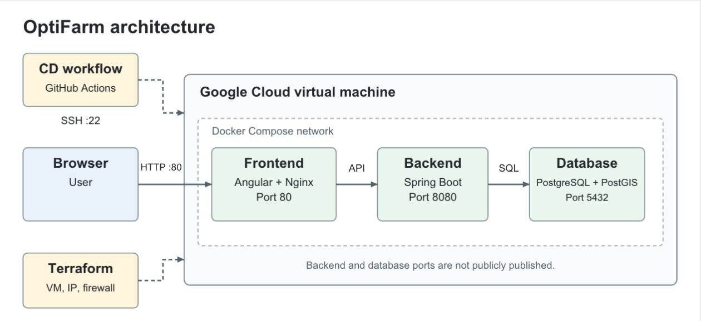
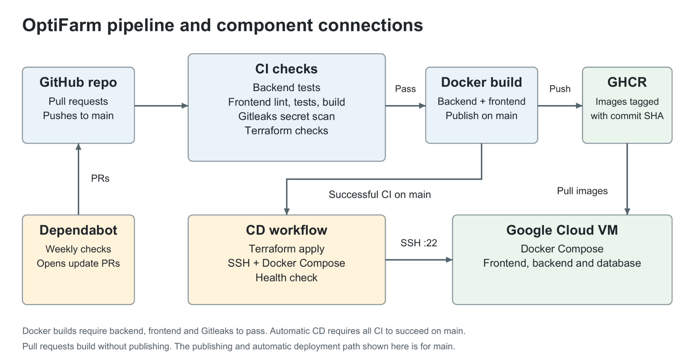

# OptiFarm: DevOps Project Report

## 1. The Project

For this project, we built a DevOps workflow around OptiFarm, a farm management application that Moritz developed with his classmates in a previous course. It manages fields, crops, equipment and farm tasks. Our goal was not to build a new application, but to connect automated testing, deployment, infrastructure configuration and security checks in one repository. We use GitHub to manage the code, review changes through pull requests and run the workflows.

The project is running at [http://34.51.196.41](http://34.51.196.41).

## 2. Architecture

OptiFarm uses Spring Boot 3 and Java 21 for the backend, Angular 19 for the frontend, and PostgreSQL with PostGIS for geographical data. The previous version of the project used GitLab and a Kubernetes cluster provided by the course's lecture team. We replaced that setup with GitHub Actions, proper secret handling and a Google Cloud Compute Engine VM that runs the containers.

The VM runs three containers through Docker Compose: Angular served by Nginx, Spring Boot and PostGIS. Port 80 is the public entry point through Nginx for the website and API requests. Port 22 is used for SSH deployment and administration. The backend and database ports are not published by production Compose.

Terraform defines the static IP address, firewall rule and VM. A startup script installs Docker if needed, prepares the deploy user and creates the application directory. Terraform state is stored in Google Cloud Storage.

## 3. Process

Continuous integration, `.github/workflows/ci.yml`, runs on pull requests and pushes to `main`. It checks the backend with `mvn verify`, including Checkstyle, 119 unit and integration tests, and JaCoCo coverage reporting. The frontend runs lint, Karma tests and a production build. CI also validates the Terraform configuration and uses Gitleaks to check for potential secrets. Dependabot separately opens dependency update pull requests for review.

After the backend, frontend and Gitleaks checks pass, CI builds both Docker images. On `main`, it publishes them to GitHub Container Registry (GHCR), tagged with the commit SHA so each image can be linked to its code version.

Continuous deployment, `.github/workflows/cd.yml`, starts after successful push triggered CI on `main`. It runs `terraform apply` to create or update the infrastructure. Terraform defines the VM, static IP and firewall, while a startup script installs Docker if needed and prepares the deployment user and application directory.

CD then connects to the VM through SSH, copies the production Compose file and writes an `.env` file using GitHub Actions secrets. It uses the temporary `GITHUB_TOKEN` to log in to GHCR, pulls the matching images we created in the CI build and starts them with Docker Compose. Deploying the image we built in the CI pipeline follows the "build once, ship what you tested" principle. A final health check confirms that the website responds and the backend login endpoint can be reached.

## 4. Design Choices and Component Interaction

We chose GitHub Actions because it keeps the code, pull requests and automation in one place. We separated CI and CD to make testing and deployment easier to follow. The automatic CD condition requires a successful CI run caused by a push to `main`, so a pull request test does not deploy the application.

We chose Google Cloud because the trial credits were free and available to us, which made it practical for a student project. It has an easy account setup, simple to use and offered everything we needed. It is a very well known infrastructure provider which makes a good choice for this project, apart from the practical reasons we mentioned. Terraform defines the static IP address, firewall rule and VM. A startup script installs Docker if needed, prepares the deploy user and creates the application directory. Terraform state is stored in Google Cloud Storage.

Some parts of the Google Cloud setup were done by hand, because the pipeline needs them to run. Initially we set up a google cloud project with billing, a Google Storage bucket that holds the Terraform state, and a service account for the pipeline with the permissions to manage the VM, the static IP and the Firewall, and to read and write the state bucket. The pipeline authenticates as this service account through Workload Identity Federation. GitHub issues a short lived token for each workflow run, Google Cloud accepts it only for this repository. This avoids a long lived service account key which can be leaked. The first "`terraform apply`" ran locally to "see it in action" and to get familiar with terraform.

Also we need the VM's address and host key as GitHub secrets before the deploy job can connect. We gathered these in the first "local" run. Since then, the infrastructure is managed using the pipeline.

GHCR login uses the short lived `GITHUB_TOKEN` instead of a stored personal access token. The SSH host key is pinned in a GitHub secret to verify the VM's identity, although this requires manual setup. Application defaults are defined in `application.yml` and can be overridden by environment variables. `.env.example` files document the configuration, while deployment credentials are supplied through GitHub secrets rather than committed to the repository.

We decided to deploy our system in one VM with Docker Compose instead of using Kubernetes, because the project instructions asked us to build a coherent pipeline and not a large system. We decided to not use e.g. Kubernetes, because that is more suited for scaling large scale applications, and our small system runs well on a small sized VM which makes it a good choice.

## 5. Quality and Security Automation

Checkstyle and frontend lint catch style and code issues, while automated tests check application behaviour. JaCoCo produces a coverage report, although generating coverage does not by itself mean the test suite is complete.

Dependabot checks Maven, npm, GitHub Actions, Docker and Terraform dependencies weekly and opens update pull requests, with related Angular packages grouped for review. Updates are not merged automatically because we want to check compatibility and keep upgrades manageable. Since OptiFarm is an older project, many dependencies are behind newer releases. Some proposed major upgrades failed CI or raised compatibility concerns, so we excluded Angular major version updates to avoid getting changes that could break the application. Due to the project's time limit, we left the dependency update pull requests unmerged. Dependabot is therefore active and working, but merging its proposed updates remains future work.

Before adding Gitleaks to CI, we scanned the available Git history locally, the scan reported no leaks. The CI job now scans commits in the CI pipeline and the full checked out history, redacting detected values in its output. If it finds any leaked secrets, the pipeline will fail.

## 6. Problems Encountered and Lessons Learned

Reusing the old project exposed several environmental differences. Maven used a different Java version from the one shown by `java -version`, which caused verification failures. This taught us to check the tools actually used by the build, not only the versions we expected. CI now explicitly selects Java 21 and Node 22.

We also encountered Testcontainers failures when Docker Hub requests failed or image downloads timed out. A rerun passed without code changes, suggesting an external download problem rather than a test regression. The pipeline still depends on that external service, prepulling images with retries would be a possible improvement.

Other problems came from workflow configuration. Docker images built in one job were not available in another because GitHub hosted jobs use separate runners. An unsuitable deployment trigger prevented CD from starting, and a missing registry token secret resulted in an empty password. Small spelling mistakes and missing variable markers also caused failures. Working through these issues helped us understand the boundaries between jobs, events and secrets rather than treating the workflow as one long script.

## 7. Limitations and Trade-offs

A big limitation in our project is that we only have a single VM, which if the VM fails, the whole system breaks and Compose updates can briefly interrupt service. Database data survives container replacement through a Docker volume, but there is no automated backup or recovery process, replacing the VM or losing its disk can lose the data.

Another limitation we were willing to live with is that replacing the VM deletes the database. A persistent disk, or a managed database, would fix this. Assuming that we keep the VM running for the system to keep running, so we argue that a VM replacement would not happen. That's why we stick to this decision.

The application currently uses HTTP rather than HTTPS, so passwords and authentication tokens are not encrypted in transit. SSH is reachable from the internet because deployment comes from GitHub hosted runners. Adding TLS, stronger deployment access controls and database backups would be priorities before using real user data.

Some environment files were committed in the original history and later removed from the current repository. We have not rewritten that history. A clean Gitleaks result does not prove those older values were harmless or are no longer used, any exposed credential must be revoked or replaced. A private repository is not a substitute for doing this. But we obviously regenerated fresh production values that were kept secret.

Other limitations include floating container base tags, limited frontend tests and old configuration from the previous course. SHA tags identify application builds, but changing base images still affects reproducibility. Updates, testing and cleanup need ongoing attention.

The AI use can be found in the AI_Usage.md file.
